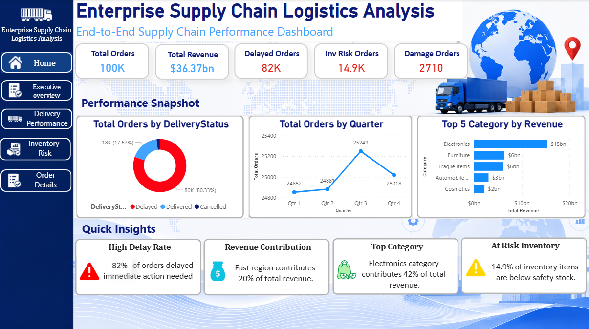
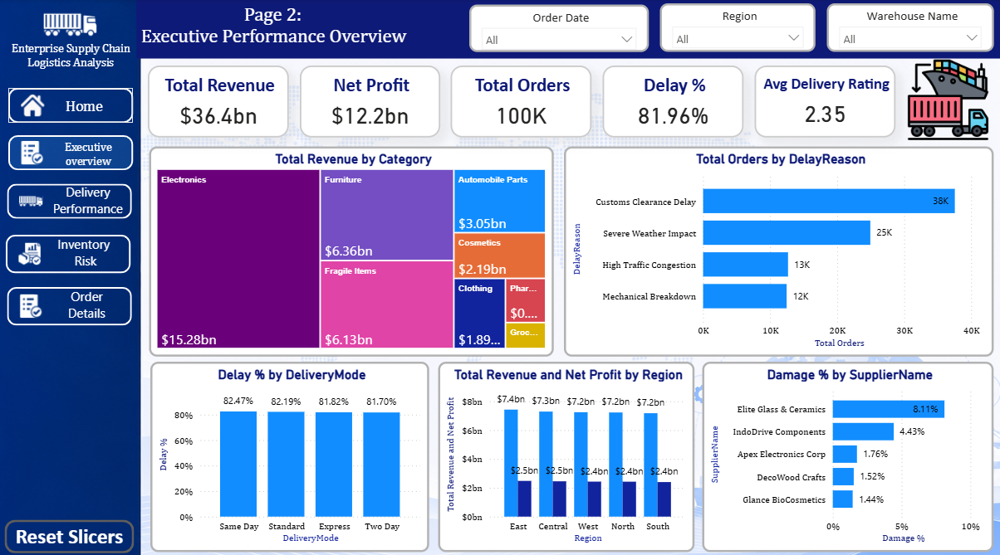
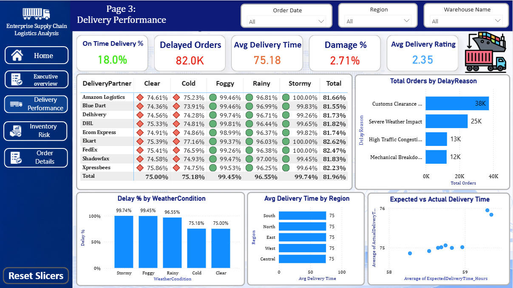
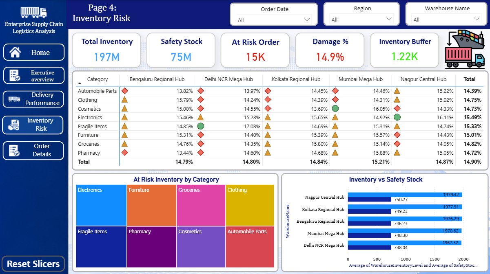
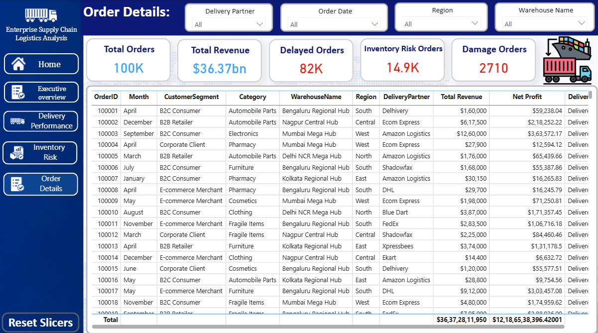

# Enterprise Supply Chain & Logistics Optimization Platform

<p align="center">
  
  
  
  
</p>

## Project Overview

Enterprise Supply Chain Logistics Analysis is an end-to-end Power BI analytics solution designed to monitor and optimize supply chain operations through interactive dashboards and business intelligence reporting.

The project focuses on delivery performance, inventory risk monitoring, supplier quality assessment, operational efficiency, and order-level analysis. The dashboard provides actionable insights that support data-driven decision-making across logistics and supply chain functions.

The solution combines data preparation, data transformation, data modeling, DAX calculations, and interactive visualizations to convert raw operational data into meaningful business insights.

---

## Business Objective

Supply chain organizations face challenges related to:

- Delivery delays
- Inventory shortages
- Product damages
- Supplier performance monitoring
- Logistics efficiency
- Operational visibility

The objective of this project is to develop an interactive Power BI dashboard that enables stakeholders to identify operational bottlenecks, monitor key performance indicators, and improve supply chain performance.

---

## Dataset Information

The project uses an enterprise supply chain dataset containing operational, inventory, warehouse, supplier, and logistics information.

### Dataset Characteristics

- One Year of Operational Data
- Order-Level Transaction Records
- Multiple Warehouses
- Multiple Suppliers
- Multiple Delivery Partners
- Multiple Product Categories
- Revenue and Profit Metrics
- Inventory Monitoring Metrics
- Delivery Performance Metrics

**Dataset File:** `Enterprise_Supply_Chain_Master.csv`

**Dataset Location:** `Dataset/Raw_Data/Enterprise_Supply_Chain_Master.csv`

*Note: Exact record counts and numerical dataset characteristics should be updated according to the final dataset used in this repository.*

---

## Data Model

### Fact Table

- Fact_Orders

### Dimension Tables

- Dim_Product
- Dim_Customer
- Dim_Supplier
- Dim_Warehouse
- Dim_Partner

The data model follows a star schema approach for efficient reporting and analytical performance.

The fact table stores transactional information, while dimension tables provide descriptive information for filtering, grouping, and analyzing business performance.

---

## Dashboard Pages

### Page 1: Home

Executive landing page providing an overall snapshot of supply chain performance.

#### KPIs

- Total Orders
- Total Revenue
- Delayed Orders
- Inventory Risk Orders
- Damage Orders

#### Insights

- High Delay Rate
- Revenue Contribution
- Top Revenue Category
- Inventory Risk Status

---

### Page 2: Executive Performance Overview

Provides high-level operational and financial performance analysis.

#### Visualizations

- Revenue by Category
- Delay Reason Analysis
- Revenue and Profit by Region
- Damage Percentage by Supplier

#### KPIs

- Total Revenue
- Net Profit
- Total Orders
- Delay Percentage
- Average Delivery Rating

---

### Page 3: Delivery Performance

Focused on delivery efficiency and delay investigation.

#### Visualizations

- Delay Performance Heatmap
- Delay Reason Analysis
- Delay Percentage by Weather Condition
- Delivery Partner Analysis

#### KPIs

- On-Time Delivery Percentage
- Delayed Orders
- Average Delivery Time
- Damage Percentage
- Average Delivery Rating

---

### Page 4: Inventory Risk

Monitors inventory health and stock exposure.

#### Visualizations

- Inventory Risk Heatmap
- Inventory versus Safety Stock
- At Risk Inventory by Category

#### KPIs

- Total Inventory
- Safety Stock
- At Risk Orders
- Inventory Risk Percentage
- Inventory Buffer

---

### Page 5: Order Details

Operational drill-through page for detailed order-level analysis.

#### Features

- Order Tracking
- Delivery Status Monitoring
- Revenue Tracking
- Profit Tracking
- Inventory Risk Monitoring
- Damage Monitoring

---

## Key Performance Indicators

| KPI | Description |
|---|---|
| Total Revenue | Total revenue generated from orders |
| Net Profit | Overall profitability |
| Total Orders | Number of processed orders |
| Delay Percentage | Percentage of delayed orders |
| On-Time Delivery Percentage | Orders delivered on schedule |
| Average Delivery Rating | Customer delivery satisfaction |
| Damage Percentage | Percentage of damaged orders |
| Inventory Risk Percentage | Inventory below safety stock |
| Inventory Buffer | Available inventory above safety threshold |

---

## Key Business Insights

### Delivery Performance

- Delivery delays can be analyzed to identify operational bottlenecks.
- Delay Reason Analysis helps identify major contributors to delayed deliveries.
- Weather conditions and delivery partner performance can be compared to understand delivery efficiency.

### Revenue Performance

- Revenue contribution can be compared across product categories.
- Regional revenue analysis helps identify high-performing business regions.
- Profitability can be evaluated across different regions and product categories.

### Inventory Risk

- Inventory levels can be compared against safety stock requirements.
- Product categories with higher inventory exposure can be identified.
- Inventory Buffer helps monitor available stock above the safety threshold.

### Supplier Quality

- Damage rates can be compared across suppliers.
- Supplier-level monitoring can help identify quality-related issues.
- Performance analysis can support better supplier evaluation and operational decisions.

*Business insights and numerical conclusions should be finalized using the actual results generated from the Power BI report.*

---

## Tools and Technologies

- Power BI Desktop
- Power Query
- DAX
- Data Modeling
- Microsoft Excel
- CSV Dataset
- Data Visualization
- Business Intelligence Reporting
- Git and GitHub

---

## Repository Structure

```text
Courier-Logistics-PowerBI/
│
├── Dataset/
│   └── Raw_Data/
│       └── Enterprise_Supply_Chain_Master.csv
│
├── Documentation/
│   └── Business_Requirements_&_Data_Dictionary.txt
│
├── PowerBI/
│   └── Courier_Logistics.pbix
│
├── assets/
│   ├── home_page.png
│   ├── executive_overview.png
│   ├── delivery_performance.png
│   ├── inventory_risk.png
│   └── order_details.png
│
└── README.md
```

---

## Dashboard Screenshots

### Home Page



### Executive Performance Overview



### Delivery Performance



### Inventory Risk



### Order Details



---

## How To Use

1. Download or clone the repository.
2. Open the `PowerBI` folder.
3. Open `Courier_Logistics.pbix` using Microsoft Power BI Desktop.
4. If required, update the dataset source path in Power Query.
5. Refresh the dataset to load the latest data.
6. Interact with filters and slicers to explore operational insights.
7. Navigate across dashboard pages using the built-in navigation menu.

---

## Project Highlights

✔ End-to-End Supply Chain Analytics

✔ Executive-Level KPI Monitoring

✔ Delivery Performance Investigation

✔ Inventory Risk Assessment

✔ Supplier Quality Analysis

✔ Interactive Power BI Dashboard

✔ Star Schema Data Modeling

✔ DAX-Based KPI Development

✔ Power Query Data Transformation

✔ Business-Focused Data Visualization

---

## Author

### Vikash Prajapat

Computer Science & Engineering (Data Science)

GitHub: [Vikashprajapat959](https://github.com/Vikashprajapat959)

---

## Project Attribution

This repository contains adaptations and independent modifications to an existing supply chain analytics project. Original contributions and reused materials should retain appropriate credit in accordance with their applicable license.

---

## License

This project is intended for educational, portfolio, and demonstration purposes. Reused materials remain subject to their original license and applicable permissions.