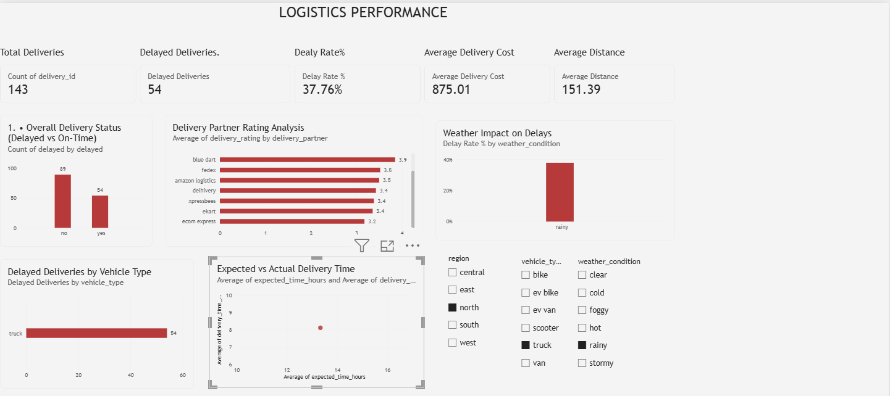
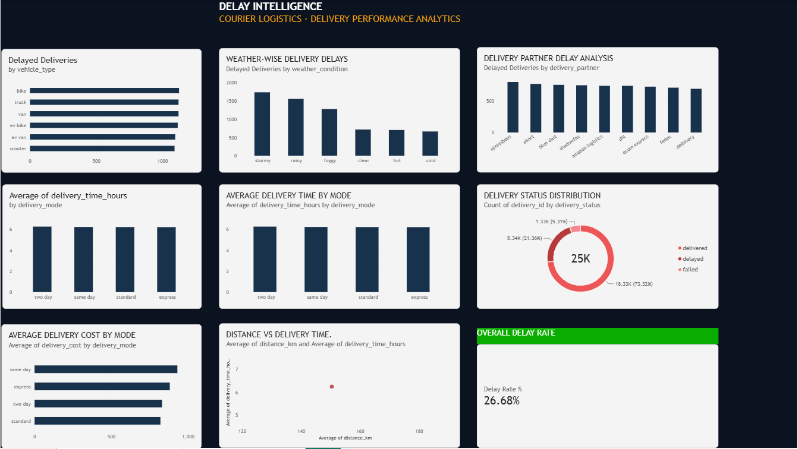

# LOGISENSE AI — Logistics Intelligence & Delivery Optimization System

An interactive **Microsoft Power BI analytics dashboard** designed to explore courier delivery performance, identify delay patterns, and understand logistics operations through data-driven visualizations.

LOGISENSE AI brings delivery KPIs, vehicle comparisons, weather analysis, delivery partner performance, and cost insights into an organized, interactive reporting experience.

## Dashboard Preview

### 1. Executive Overview



Explore overall delivery performance through KPI cards, delivery delay analysis, vehicle comparisons, weather patterns, partner ratings, and delivery-time comparisons.

### 2. Delay Intelligence



Explore delivery delays by vehicle type, weather condition, delivery partner, and delivery mode, alongside delivery status, cost, distance, and delivery-time analysis.

## Project Highlights

- **Delivery Performance KPIs:** Total deliveries, delayed deliveries, delay rate, average delivery cost, and average distance.
- **Delay Intelligence:** Analyze delay patterns across vehicles, weather conditions, and delivery partners.
- **Operational Analytics:** Compare delivery modes, delivery status, delivery costs, and delivery times.
- **Interactive Filters:** Filter report results by region, vehicle type, and weather condition on the Executive Overview page.
- **Visual Reporting:** Use charts and KPI cards to explore operational patterns and communicate findings.

## Technology Stack

| Component | Technology |
|---|---|
| Business Intelligence | Microsoft Power BI Desktop |
| Data Source | CSV |
| Data Analysis | Power Query and DAX measures |
| Visualizations | Power BI charts, KPI cards, and slicers |
| Version Control | Git and GitHub |

## Key Performance Indicators

The report includes the following measures:

- **Total Deliveries** — Total records in the loaded delivery dataset.
- **Delayed Deliveries** — Deliveries marked as delayed.
- **Delay Rate (%)** — Delayed deliveries divided by total deliveries.
- **Average Delivery Cost** — Average recorded delivery cost.
- **Average Distance** — Average recorded delivery distance.

Actual KPI values depend on the loaded dataset and active filters. Verify all figures in Power BI before using them as final findings.

## Repository Structure

```text
Courier-Logistics-PowerBI/
├── Dataset/
│   └── Raw_Data/
│       └── Delivery_Logistics.csv
├── Documentation/
├── PowerBI/
│   └── Courier_Logistics.pbix
├── Screenshots/
│   ├── logistics-dashboard.png
│   └── delay-intelligence.png
└── README.md
```

## How to Run the Project

1. Clone or download this repository.
2. Install and open **Microsoft Power BI Desktop**.
3. Open `PowerBI/Courier_Logistics.pbix`.
4. If prompted, update the data source path to `Dataset/Raw_Data/Delivery_Logistics.csv`.
5. Apply any required Power Query changes and refresh the dataset.
6. Check the visuals, KPI calculations, and slicer interactions.

## Data and Limitations

- The project uses the CSV dataset included in the repository.
- The original dataset source and licence should be documented once verified.
- Dashboard relationships are exploratory and do not establish causation.
- This repository documents a Power BI analytics dashboard; it does not establish a live logistics integration or a validated AI prediction model.
- Validate data quality, DAX calculations, and report behaviour before drawing operational conclusions.

## Future Improvements

- Document the dataset source and data dictionary.
- Add verified analytical findings and actionable recommendations.
- Improve report navigation, formatting, and visual consistency.
- Test data refresh and report functionality from a fresh repository clone.

## Author

**Vikash Prajapat**

**Project:** LOGISENSE AI — Logistics Intelligence & Delivery Optimization System

---

*Built with Microsoft Power BI to explore